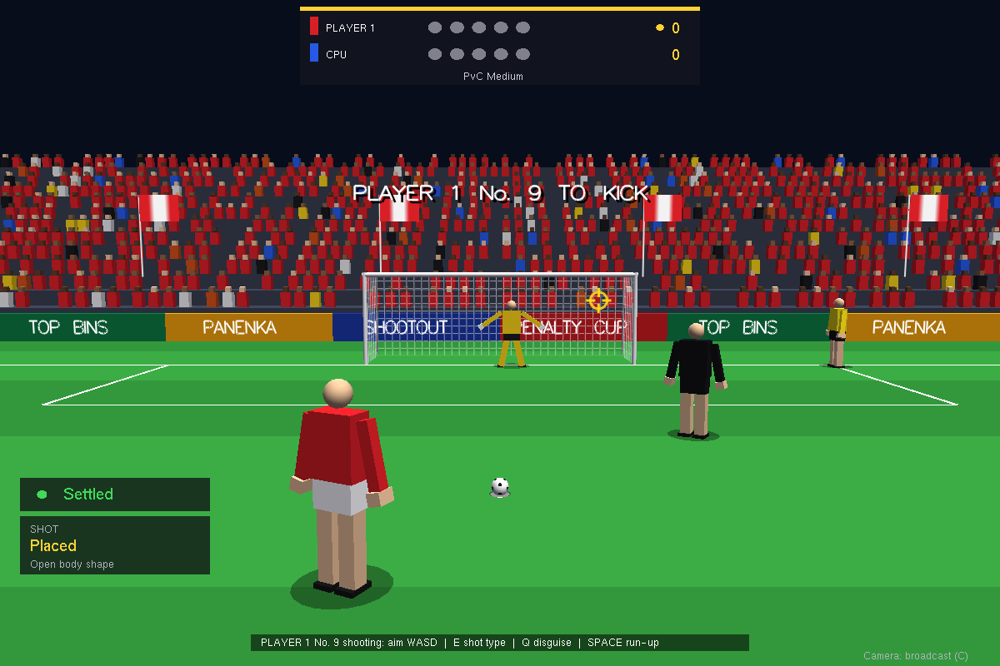

# Penalty Shootout (OpenGL)

A 3D penalty shootout written in Python with PyOpenGL and GLUT. Play against the computer or a friend on one keyboard, on a pitch built to real-world dimensions under the floodlights.



## Ultimate Football (new, in progress)

`football_game.py` is the start of a full football game built on [Panda3D](https://www.panda3d.org/), using the same roster of legends, icons, current stars and fantasy players. It runs alongside the penalty game, which stays available from its menu.

```bash
python -m pip install panda3d numpy
python football_game.py
```

What is in this first version:

- **Formats**: cage 5-a-side with rebound walls (the default), 5-a-side, 7-a-side and 11-a-side.
- **Teams**: Legends, All Stars, Queens, Pioneers, Myths and Cult Heroes, built from the characters, plus five club sides.
- **Modes**: 1 player against the computer, 2 players head to head, 2 players on the same team, a penalty shootout, Cup Run, or watching CPU against CPU. Draws go to penalties.
- **Cup Run**: four knockout ties (Round of 16 to the Final), each harder than the last. After every win you pick one of three perks for the rest of the run: faster shots, a bigger engine, sharper passing, quicker feet or a keeper with longer reach.
- **Difficulty**: Beginner, Amateur, Pro, World Class and Legendary. **Style**: Arcade, or Authentic (slower, less accurate, with offside on full pitches).
- **Football**: assisted passes, through balls, lobs and crosses; shots with power and placement, finesse curlers and chips; headers and first-time volleys; skill moves; sprinting knocks the ball ahead. Defending uses press and tackle, slide tackles, and calling a second man. There are fouls, cards, free kicks, penalties, corners, throw-ins and goal kicks.
- **Team AI**: the team keeps its shape and presses, marks, makes support runs, plays passes based on the passing lanes, and has keepers who position themselves, dive, catch, parry, rush out and distribute.
- **Team styles**: every side plays its own way. Legends keep the ball, All Stars break on the counter, Queens press high, Pioneers go direct, Myths are chaos and Cult Heroes sit in a low block. The team-select screen tells you who plays how.
- **Forgiving controls**: a pass or shot pressed a split second after the ball runs off your foot still counts, an early tackle still goes in, and the stick steers your first touch (leave it alone to kill the ball dead, push it across your body to turn, sprint to knock it into space).
- **Wall passes**: in the cage, passes go off the boards when a defender is in the way, for you (the guide bends off the wall to show it) and for the computer.
- **Penalties**: one system for penalties in a match and the shootout. Aim a ring with the stick, hold shoot and release in the sweet zone of the power bar (too hard and it flies over), E to curl it, lob for a Panenka. In goal, pick a dive with the stick and a button before the kick. Takers use the composure, power and placement ratings from the classic game, and the shootout shows each side's chances of winning.
- **Weather** (Kick off menu): rain gives a quick, skiddy ball, slippery keepers and tacklers who lose their footing; snow slows the ball right down (and it turns orange); wind carries lofted balls, and the HUD says which way it blows. Rain and snow fall in the stadium.
- **Give-and-go**: keep pass held after a pass and the passer bursts forward; let go and the ball comes straight back into his path. A quick tap is still just a pass.
- **Game management**: a side leading late takes its time over restarts and runs the ball into the corner; a side chasing the game sends its keeper up for a last-minute corner.
- **Pitch guides** (Settings or Pause, on by default): a ring under the team-mate your pass will find, the through-ball lane, a white ring under the player a switch would give you, and the offside line on Authentic full pitches.
- **Presentation**: a floodlit stadium with crowds that react, a broadcast camera (plus tactical, end-to-end and third-person cameras), goal replays, captions from the commentary, a radar, and a scoreboard and HUD that scale with the window.

**Controls** (both players can share a keyboard, and gamepads work as well):

| Action | Player 1 | Player 2 | Gamepad |
|---|---|---|---|
| Move | W A S D | Arrows | Left stick or D-pad |
| Pass, or press and tackle when defending (hold to press) | J | / | A |
| Shoot (hold for power), or slide tackle | K | . | B |
| Through ball, or call a team-mate to press | L | , | Y |
| Lob or cross (with finesse held: chip shot) | I | ; | X |
| Sprint | Left Shift | Right Shift | RT |
| Switch player | Q | Right Ctrl | LB |
| Finesse (hold while shooting to curl it) | E | ' | RB |
| Skill move | Space | Enter | LT |
| Pause | Esc | | Start |

**Soak test and balance report** (no window needed): `python tools/sim_matches.py -n 200 --format full` plays CPU v CPU matches flat out and prints goals, shots, passing, fouls and set pieces, how each team style plays (`--compare-styles` uses identical squads), and any stuck states (a crash, a dead ball, a restart nobody takes, players outside the ground) with the seed to replay them (`--replay SEED`). `--weather random` mixes in rain, snow and wind. Matches are deterministic: the same seed and the same inputs always play out the same way, which is tested.

Keys can be changed under Controls; a key that is already in use swaps with the other action. Settings are saved in `~/.ultimate_football/`.

## What makes it play like a real shootout

**Taking the kick**
- **Aim, power and timing.** Move a reticle anywhere on the goal mouth (or off it), pick a shot type, then stop the power bar during the run-up. Green is the sweet spot; over-hit it and the ball climbs over the bar. Aim tight to a post and you might hit it, or miss altogether.
- **Seven shot types.** Placed, Driven, Curler, Chip / Panenka, Knuckleball (no spin, wobbles late, hard to hold), Skidder (low, fizzes off the turf) and the Stutter (hop, wait for the keeper to move, roll it the other way: slow if he holds his ground).
- **Body shape gives you away.** Your hips open towards where you are aiming during the run-up, and both human and computer keepers can read it. Pick a run-up: angled (more pace, easier to read), straight, or disguised (hides your body shape at a small cost in accuracy). Left-footers come in from the other side.
- **Squads with ratings.** Every taker has composure, power and placement, a stronger foot and his own habits. Choose who kicks when (put a cool head fifth), and bring on fresh subs just for the shootout: they hit it harder but are cold for their first kick. A lower-third caption shows each taker's ratings and his record from the spot.
- **Gaze and ritual.** Stare the keeper down (calmer, but his antics bite harder) or look away. After the long walk, take your time placing the ball to settle the nerves.
- **Composure.** Rushing the kick straight after the whistle makes it shakier; a calm breath helps; dithering lets the crowd get to you. A breathing indicator shows where you are.
- **Slips and double touches.** A worn spot, a wet pitch or an over-hit drive can make your plant foot go. A slip skews the ball, and a double touch is ruled out by VAR.
- **The long walk.** Each taker walks from the halfway line (skippable), towards his own fans' roar or the away end's whistles. Everyone kicks once before anyone kicks twice; after ten outfielders, the goalkeeper steps up.

**Keeping goal**
- **Guess, or react late.** Pick a dive before the kick (it stays hidden), or wait for a split second of reaction after contact. Feet can save a shot down the middle.
- **Mind games.** Shuffle along the line to make one side look bigger, fake a lean, wave your arms, point to a corner, or pick the ball up and make the kicker wait. Overdo it and the referee books you; leave your line early and VAR orders a retake. Two yellows and an outfield player has to go in goal.
- **Fingertips and parries.** Press shoot again as the ball arrives for a fingertip stretch (too early and you are over-stretched). Hold a direction to push a parry round the post, or down to palm it in front.
- **Water-bottle notes.** Against a computer kicker you get the scout's note on his favourite side. Usually right.
- **Specialist sub and keeper style.** Before the shootout, bring on a penalty-specialist keeper with a longer reach (but he is a worse kicker), and pick a tall, slower keeper or a small, explosive one.
- **Momentum.** Saves give a keeper confidence; misses make the next kicker more nervous. Keepers celebrate saves with a dance.

**Atmosphere**
- **Home and away ends.** The toss winner chooses which end. The fans behind the goal wear their team's colours, do a Mexican wave, unfurl a tifo, wave flags and jump around to put off the away kicker.
- **Weather and time of day.** Rain (skidding ball, slippery spot, spilled catches), wind (drift, worst on chips), snow (orange ball), fog, and day or night with floodlights, phone torches and flares.
- **The full cast.** A referee who shows cards, an assistant on the goal line, both squads arm in arm on the halfway line reacting to every kick, and the kicker's celebration of your choice. Celebrations spread: a knee slide lifts your side and needles theirs, and shushing the away end fires them up.
- **Commentary.** A line for every walk and every kick, as captions or read aloud (with `pyttsx3` installed), and a live win-probability bar worked out exactly from the score.
- **Pitches.** A stadium, jumpers for goalposts in the park (no bar: the keeper decides if it was over), a futsal court (3 x 2 m goal, 6 m spot, a heavy ball) and a beach (sand kills a rolling ball).

**Modes**
- **Player v CPU** and **Player v Player** on one keyboard or over a LAN: 3, 5 or 10 kicks each, or sudden death only, in the usual ABAB order or the ABBA order trialled in 2017. Pick your teams.
- **Manager**: you pick the takers, the subs and the keeper, then watch them do it.
- **Famous shootouts**: Belgrade 1976, Berlin 2006, Lusail 2022, Wembley 2021, Istanbul 2005 (you are in goal), Munich 2012, Pasadena 1994 and 1999, Moscow 2008 and Basel 2025, each picked up at the deciding kick with a history card before and after. Only team names and kit colours are used.
- **Tournament**: eight teams, every tie on penalties, the keepers getting sharper each round.
- **Career**: single penalties against stronger rivals as you climb, earning XP, traits and a gold kit, as a striker or a keeper.
- **Challenges**: Top Bins (no keeper, hit the hoops in the corners), Panenka only, save three in a row, and sudden-death survival, with your bests saved.
- **Daily shootout**: the same kicks and dives for everyone today. Share the result grid.
- **Ghost duels**: press `B` after a shootout to save your kicks; a friend faces them exactly as struck (`--duel FILE`, or the Ghost duel mode), then tries to beat your score.
- **Tutorial**: a coach walks you through the controls on first run.
- **90th-minute penalty**: 1-1 in normal time, and rebounds are live.
- **Party** for 3 to 8 friends: King of the Goal, or a knockout bracket of quick shootouts.
- **Training ground**: a trajectory preview, an all-time success heatmap by zone, and a drill machine that fires at the zone you pick when you keep.

**Presentation**
- **Cameras**: broadcast, behind the goal, side, a keeper's-eye view with your gloves in shot, and a free orbit. Replays slow right down at saves and post hits, with net, ball and side cameras.
- **Saved replays and clips**: save a shootout as a small replay file that re-simulates every kick (`--replay FILE` to watch), or export the replay as a GIF.
- **Accessibility**: scoreboard ticks and crosses as well as colours, a relaxed timing assist (slower power bar, wider sweet spot), captions for sound cues, and rebindable keys.
- **Private aiming for PvP**: a gamepad rumbles to tell the kicker where the hidden aim is, or the kicker can aim on a phone.
- **Sound and stats**: whistle, kick, the clang of the post, crowd roars, gasps and jeers, a heartbeat on must-score kicks, and your career record saved between sessions.
- **Coach's report**: after a match, `Tab` shows the patterns in how you played (always the same corner? rushing?).
- **Achievements**: sixteen of them, from a Panenka to a fingertip save (`L` in the menu).
- **Photo mode**: `Y` freezes the moment; orbit the camera and save a PNG without the HUD.
- **Auto difficulty**: adjusts after every kick so you score about three in four.
- **Mods**: drop JSON files in `~/.penalty_shootout/mods` to add famous shootouts, teams or characters (see below).

## Characters

Set **Characters** in the menu to *Club* (generated squads), *Legends* (drafted from the roster) or *Pick* (choose your own on the select screen). There are 90 of them: all-time legends, cult icons and meme heroes, current men's and women's stars, keepers, and a fantasy set with auras to match. Real names are used for fun only and all live in `shootout/characters.py`, so they are easy to rename.

- **Looks, names and numbers.** Skin, hair, beards, headbands, boots, gloves and build, with the name and number on the back of the shirt. Faces change with the moment (focused, nervous, grinning, gutted), and the camera closes in during the ritual.
- **Personalities.** Takers are Ice Cold (antics bounce off), Showboat, Hothead (takes the bait), Thinker (always takes the ritual), the Kid (fifth kick nerves), Clutch (better when it matters) or Steady. Keepers are Dancers, Walls, Gamblers, Readers (remember your last kick), Showmen, Sweepers or Cats (better fingertips).
- **Signatures and rituals.** Hop, stop-start, Panenka, rocket, curl, low and knuckle shots become the default; keepers can have perfect notes or extra reach. Each has a mannerism (badge kiss, wiping the boots, swinging on the bar) and a celebration, from the knee slide and the aeroplane to the famous meme poses. Aura glows round the big names, rattles the other side and steadies their own.
- **Select and create.** `A`/`D` browse, `W`/`S` change the filter (legends, cult icons, current, women, keepers, fantasy, yours and mods), `Enter` picks, `X` undoes, `R` fills the rest at random. `C` (in the menu or on the select screen) opens create-a-player: pick the look, personality, signature and celebration, and share a rating budget between composure, power and placement. Created players are saved to `~/.penalty_shootout/players.json`.
- **Unlockable legends.** Some characters wait for an achievement (a Top Bins round, a keeper's goal, a fingertip save, a sudden-death win, three saves, a tournament...).
- **Career.** Pick an avatar; every third fixture is against the same rival, who remembers which way you went last time. Story cards mark the big moments, and traits unlock gold boots, the armband, a celebration, new hair and an aura.
- **Referees, managers and teammates.** Each match gets a referee with their own tolerance for antics, time-wasting and taunts, shown at the toss. Managers watch from the touchline, the captain has a word before big kicks, and the line on halfway is the real bench.
- **Commentary and form.** Lines for each character, personality and celebration, keeper banter that remembers earlier kicks, and form that rises with scored fifth kicks and dips with misses, fading over a few games.

## Graphics

Set **Graphics** in the menu to *Low*, *Medium* or *High* (saved in `~/.penalty_shootout/graphics.json`). On the first launch the game times a few frames and picks the setting for your computer. Low is the classic fixed-function look and runs anywhere. Medium and High draw through GLSL shaders, and if the shaders or framebuffers are not available the game drops back to Low and says why.

- **Lighting and shadows.** Per-pixel lighting with a sky-and-grass ambient, specular highlights on boots, the ball, the frame and wet grass, a broadcast rim light on the players, and shadow maps from the sun or the main floodlight (four soft floodlight shadows at night).
- **Anti-aliasing and post-processing.** A multisampled frame, then bloom round the floodlights, LEDs and auras, a vignette, colour grading per weather and time of day, depth of field on the taker's close-up and on the walk, motion blur on a rocket, and heat haze round the strongest auras (High).
- **The pitch.** Procedural grass with mower stripes that change with the viewing angle, a worn goalmouth and a penalty spot that gets churned up kick after kick, divots kicked up by a slip, and grass blades round the spot and the goal.
- **Stadiums.** Choose the *Classic bowl*, *Derby night* (flare smoke drifting through the beams), *Old terraces* (pylons and a hand-turned scoreboard), *Future arena* (an LED ribbon and a roof that slides shut in rain and snow) or *Nordic winter*. Two-tier stands with roofs, a tunnel and dugouts, corner flags in the wind, LED boards that scroll and flash GOAL! in the scorer's colours, and a big screen that shows the live picture and replays (High). For a *Golden sunset* beach, pick the beach pitch with the sunset kick-off.
- **The crowd.** Scarves held up, the home end on its feet for the decisive kick, phone flashes popping round the ground on big kicks, and the away end emptying after a defeat.
- **Players.** Rounded, tapered bodies with sleeves, collars, knees and elbows that bend, shirts that flap and hair that swings. Poses blend into each other: the strike follows through, the plant foot sticks, and a full-stretch dive lands and rolls. Kits and gloves pick up mud from slips, dives and the rain.
- **Ball and net.** Panels in the tournament design and the taker's colours, a visible knuckleball wobble, scuffs after it hits the woodwork, a light trail on a rocket, and a cloth net that ripples round the ball and sags in the rain.
- **Weather and light.** Rain splashes off the pitch and the players, puddles that mirror the lights, spray behind a skidding ball and drips off the bar; snow that settles over the match and keeps the footprints. Kick off at *Dusk into night* and the sky darkens over the shootout while the floodlights come on bank by bank, with beams visible in fog and drizzle.
- **Broadcast.** A steadicam walk from halfway, an animated score bug and player cards, shot speed and xG with a heatmap of the match's kicks, and replays cut like TV: spider cam over the run-up, a super slow-motion strike, the net cam, and goal-line technology with a 3D graphic for tight calls (`C` picks a camera, or leave it on the director's cut).
- **The winning kick.** Slow motion, the camera circling the hero, confetti and fireworks, and the bench sprinting on to pile on.
- **Photo mode extras.** `F` filters (mono, sepia, vivid, vintage, noir), `G` depth of field, `B` a poster frame and `T` the hero's name stamped on the picture.
- **Auras.** Light pooling on the grass, sparks with trails, heat haze for the strongest, and a gold shimmer for legends on the walk.

## How to Run

Requires Python 3.8+ and an OpenGL-capable system with GLUT (freeglut).

1. Install freeglut (see **GLUT library** below).
2. Install the Python packages and start the game:

```bash
python -m pip install -r requirements.txt
python penalty_shootout.py
```

`pygame-ce` is used for sound and gamepads (the community edition of pygame: it has wheels for new Python versions, including 3.14 on Windows, where plain `pygame` fails to install). If you already have `pygame` installed, `pip uninstall pygame` first: the two share the `pygame` module name. Without it the game runs silently and keyboard-only. `Pillow` turns exported clips into GIFs and draws the HUD's text with a TrueType font that scales with the window (without it, clips are saved as a folder of frames and the HUD uses GLUT's bitmap fonts). `PyOpenGL_accelerate` is optional: `pip install PyOpenGL_accelerate` for a little more speed.

The game turns off PyOpenGL's per-call error checking, which costs 12-20% of the CPU time. Set `SHOOTOUT_GL_DEBUG=1` to turn it back on when debugging the renderer. Frames are paced at 60 fps (with vsync where the driver allows), and `F11` switches to fullscreen and back.

To watch a saved replay: `python penalty_shootout.py --replay ~/.penalty_shootout/replays/shootout-....json`

To face a friend's ghost duel: `python penalty_shootout.py --duel duel-....json`

**LAN play**: one player runs `python penalty_shootout.py --host` and the other `python penalty_shootout.py --join <host IP>` (add `:PORT` if the host used `--host PORT`; the default is 50505). The host's window shows the exact command for the friend to run while it waits, and `Esc` goes back to the menu. Each of you plays with your own Player 1 keys. The host's settings, team names and squads (with their form) are used, and the two games run in lockstep, so only key presses cross the network; after every kick the two games compare a checksum and say so if they ever drift apart. `Esc` pauses both screens; from the pause `M` leaves for the menu. If the other player leaves, the game says so and `M` takes you back to the menu.

**GLUT library**

- Linux: install freeglut from your package manager, for example `sudo apt install freeglut3-dev` on Debian/Ubuntu.
- Windows: the PyOpenGL package from pip does not include the GLUT DLL, so `glutInit` fails with `NullFunctionError`. Get a 64-bit freeglut (for example `vcpkg install freeglut:x64-windows`) and copy `freeglut.dll` into `Lib\site-packages\OpenGL\DLLS\` renamed to `freeglut64.vc14.dll`, which is the name PyOpenGL looks for. Or use the ready-made Windows build below.
- macOS: the system GLUT framework is used.

**Windows build**: `pyinstaller --noconfirm penalty_shootout.spec` makes `dist/PenaltyShootout/PenaltyShootout.exe` with freeglut bundled (from vcpkg). The `windows build` GitHub workflow does this on every `v*` tag, or on demand, and uploads the folder as an artifact.

## Controls

**Menu**: `W`/`S` or the arrow keys move, `A`/`D` change, `Enter`/`Space` kick off, `C` create a player, `F2` rebind keys, `F3` achievements, `Esc` quit (it asks first). The mouse works too. The menu's shortcuts are function keys so they never clash with Player 2's letter keys.

**Rebinding** (`F2`): press a key for each action in turn. A key already in use swaps: the other action gets the old key. The arrow keys can be bound. `Esc` cancels and puts the old keys back.

**Pacing**: *Quick* in the menu shortens the toss, the walk, the ball placing, the result and the VAR check. Whatever the setting, `Space` or `Enter` skips any of them.

**Match** (default keys; rebind them from the menu)

| | Player 1 | Player 2 |
|---|---|---|
| Aim (kicking) / dive (keeping) | `W` `A` `S` `D` | `I` `J` `K` `L` |
| Start run-up, then set power | `Space` | `Enter` |
| Shot type (kicking) / wave arms (keeping) | `E` | `O` |
| Run-up style (kicking) / shuffle along the line (keeping) | `Q` | `U` |
| Gaze, celebration (kicking) / fake lean, pick up the ball (keeping) | `X` | `M` |
| Point to a corner (keeping) | `Z` | `,` |

When keeping, left and right pick the dive, down stays in the centre and up toggles a high or low dive. During the dive, shoot is the fingertip stretch and a held direction steers a parry. After the walk, the kicker's shoot takes his time placing the ball and the keeper's fake key picks it up. At the toss, the same keys pick the order of takers (up/down to choose, left/right to move, shoot when ready), the keeper sub (`Q`), the keeper's style (`E`) and fresh subs (`X`). Playing on your own you always use Player 1's keys (and pad 1), in goal too: training, the 90th-minute penalty, the ghost duel, the saves challenge and the tutorial. In party modes the kicker always uses Player 1's keys and the keeper Player 2's.

While aiming, one line at the bottom shows the keys you need, plus one more control to learn each kick; `H` lists them all.

| Key | Action |
|-----|--------|
| `C` | Change camera (in a replay: director's cut, net, ball, side, goal-line or spider cam) |
| `T` | Trajectory preview on/off (training) |
| `H` | How to play |
| `N` | Sound on / off |
| `Esc` / `P` | Pause (then `R` restart, `M` menu, `Q` quit) |
| `Y` | Photo mode (`A`/`D` orbit, `W`/`S` height, `Q`/`E` zoom, `F` filter, `G` focus, `B` frame, `T` name, `Enter` save) |
| `V` / `F` / `G` | After the match: watch the replay, save a replay file, save a GIF clip |
| `B` / `Tab` | After the match: share (ghost duel file, and the daily grid to the clipboard) / coach's report |
| `Space` / `Enter` | Skip a cutscene (toss, walk, ball placing, result, VAR, replay) |
| `F11` | Fullscreen on / off |

**Gamepads**: pad 1 plays as Player 1 and pad 2 as Player 2. Stick or d-pad aims and dives, A shoots, B is shot type / wave, X run-up / shuffle, Y gaze / fake, the right bumper points, Start pauses and Back changes camera. With hidden aim, the kicker's pad rumbles more towards the posts and the bar.

**Phone controller**: switch it on in the menu and the game shows an address and a six-digit PIN. Open the address on a phone on the same network, enter the PIN, and aim by touch so your opponent cannot see where you are going. The touch pad covers whatever goal is in use (park, futsal and beach goals too). The server only runs while the setting is on, a phone that gets the PIN wrong five times is locked out, and it shuts down when the game closes.

**Hidden aim (PvP):** off by default. Switch it on in the menu and the kicker's reticle is hidden on the shared screen so the keeper cannot see it: you still move it from the centre with your aim keys, so you aim by feel, with pad rumble, or on the phone controller. The keeper's choice is never shown in PvP.

## Mods

Put JSON files in `~/.penalty_shootout/mods/`. Each can hold a list of `scenarios` (same fields as the built-in ones in `shootout/scenarios.py`: `key`, `title`, `teams`, `kits`, `first`, `role`, `results`, and optional `intro` and `history`) and a list of `teams` (`name`, and `shirt`, `shorts` and `keeper` colours as RGB from 0 to 1). Bad entries are skipped.

```json
{"teams": [{"name": "Rovers", "shirt": [0.1, 0.5, 0.3], "shorts": [1, 1, 1], "keeper": [0.9, 0.8, 0.1]}]}
```

A list of `players` adds characters to the select screen under *Yours and mods*: `name` and `composure`, `power` and `placement` (0 to 1) are required; `role` (`kick` or `keep`), `number`, `foot`, `women`, `persona`, `signature`, `celebration`, `aura`, `tag`, `lines` and a `look` (`skin`, `hair`, `hc`, `beard`, `h`, `w`, `boots`) are optional. See `valid_character` in `shootout/characters.py` for the allowed values.

```json
{"players": [{"name": "Legend", "composure": 0.9, "power": 0.8, "placement": 0.85, "persona": "ice", "celebration": "siuu"}]}
```

## Difficulty (PvC)

| | Easy | Medium | Hard |
|---|---|---|---|
| Computer keeper reads your body shape | 15% | 30% | 35% |
| Keeper reach and speed | Short, slow | Medium | Long, quick |
| Computer kicker accuracy | Wild | Good | Sharp |
| Kicker exploits your favourite dive | No | A little | Yes |

**Auto** moves between easy and hard after each of your kicks, aiming for about 73% scored. When it doesn't read you, the computer keeper leans towards the side you have favoured. Computer kickers have personalities (the Placer, the Blaster, the Artist) with different shot choices and a natural side. `python tools/balance.py` prints simulated conversion rates; real shootouts convert roughly three kicks in four.

## Project Structure

```
├── penalty_shootout.py     # Entry point
├── shootout/
│   ├── config.py           # Pitch dimensions (metres), shot types, difficulty
│   ├── rules.py            # Shootout scoring and sudden death
│   ├── physics.py          # Ball flight, posts, net, shot error
│   ├── keeper.py           # Dives and the keeper's body for saves
│   ├── kick.py             # One kick in flight and the referee's call
│   ├── ai.py               # Computer kicker and keeper
│   ├── game.py             # Match flow and input (no OpenGL)
│   ├── modes.py            # Shootout, training, 90th-minute pen, party, tournament, career, challenges...
│   ├── squad.py            # Takers' ratings, the order, fresh subs, water-bottle notes
│   ├── characters.py       # The character roster, looks, personalities, created players
│   ├── winprob.py          # Exact win probability from the score
│   ├── commentary.py       # Commentary lines, captioned or spoken
│   ├── report.py           # The coach's report after a match
│   ├── achievements.py     # Achievements
│   ├── net.py              # LAN play in lockstep
│   ├── scenarios.py        # Famous shootouts
│   ├── controls.py         # Key bindings (rebindable, saved to a file)
│   ├── audio.py            # Procedural sound effects
│   ├── stats.py            # Career stats and the training heatmap
│   ├── storage.py          # Safe (atomic) saving of the settings and stats files
│   ├── render.py           # 3D scene: players, ball, net, crowd, weather and effects
│   ├── gfx.py              # Shaders, shadows, anti-aliasing, post-processing, quality setting
│   ├── stadium.py          # The grounds: stands, roofs, LED boards, big screen, floodlights
│   ├── prims.py            # Drawing primitives (rounded limbs, discs, boxes)
│   ├── hud.py              # Scoreboard, menus, banners, captions
│   ├── gamepad.py          # Gamepads and rumble (optional, via pygame)
│   ├── phone.py            # Phone controller web page (optional)
│   └── app.py              # GLUT window, cameras, the frame pipeline, clip export
├── penalty_shootout.spec   # PyInstaller recipe for the Windows build
├── tests/                  # pytest suite (runs without a display)
├── tools/balance.py        # Conversion-rate simulation
└── tools/screenshot.py     # Renders a screen to a PNG at any window size
```

Run the tests with `pip install pytest && pytest`.
